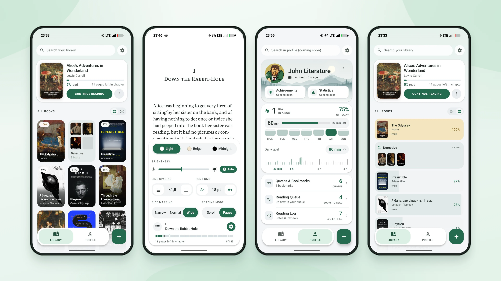
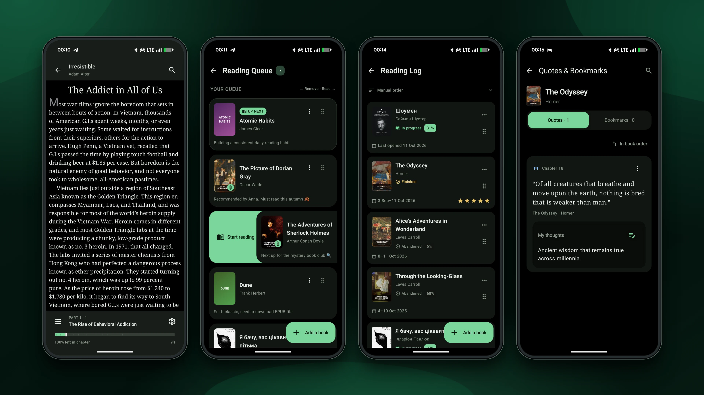

# FrogReader 🐸📖

**A beautiful, free and open-source e-book reader for Android.**

Built with **Kotlin, Jetpack Compose and Material 3**, FrogReader combines a carefully designed native interface with a dedicated reading engine, a personal library and tools to track your reading — all without an account or cloud dependency.

[](https://github.com/KNITIPKA/frog-reader/releases/tag/beta-1)
[](https://developer.android.com/)
[](https://kotlinlang.org/)
[](https://developer.android.com/jetpack/compose)
[](https://github.com/KNITIPKA/frog-reader/actions/workflows/ci.yml)
[](LICENSE)

<p align="center">
  
</p>

<p align="center">
  
</p>

### [Download FrogReader BETA 1](https://github.com/KNITIPKA/frog-reader/releases/tag/beta-1)

[Release notes](docs/releases/BETA_1.md) · [Changelog](CHANGELOG.md) · [Report a bug](https://github.com/KNITIPKA/frog-reader/issues)

**Requires Android 8.0 or later.** Download the APK from the release assets and open it on your device.

> **Beta software:** Bugs and unfinished features remain. FrogReader is not on Google Play yet. Export a backup before upgrading or installing a development build.

## Why FrogReader?

- **Designed for Android.** A responsive Material 3 interface, smooth transitions, a first-launch setup and Light, Beige and Midnight themes, with optional Material You colors.
- **Make reading your own.** Switch between pages and continuous scrolling, choose Floating or Classic controls, customize typography per book and import your own fonts.
- **Respect the book.** The native rendering engine supports publisher styling, illustrations, tables, footnotes, poetry, embedded fonts and selected advanced EPUB layouts.
- **Keep your library organized.** Browse covers or lists, create shelves, search books, edit metadata, rate titles and continue where you left off.
- **Track more than e-books.** Manage a Reading Queue and a Reading Log for digital, physical and externally read books, including rereads, reviews and reading dates.
- **Keep the passages that matter.** Save colored highlights, quotes, notes and bookmarks, then search and revisit them.
- **Your books, your data.** Read offline with no account, export full or data-only backups and schedule automatic backups.

## Reading experience

FrogReader offers **Slide, Stack, Page curl and None** page-turn options, chapter-aware progress, a page counter, volume-key navigation, adjustable brightness and optional screen wake lock. Search within a book, use an expandable table of contents, follow rich footnotes and return to your previous position after a jump.

Personalize fonts, size, line spacing, margins, alignment and hyphenation for individual books. **Literata** and **IBM Plex Sans** are bundled, with TTF/OTF import available. Right-to-left books and mixed-direction text have dedicated support, though device-specific validation is ongoing.

## Your reading hub

The **Profile** brings together recent activity, streaks and daily reading goals with three practical tools:

- **Reading Queue:** Plan future reads, reorder priorities, add notes and optionally attach files before importing them into your library. [Details](docs/reading-queue.md).
- **Reading Log:** Record books read in FrogReader, on paper or elsewhere. Track progress and status, dates, ratings, reviews, time and rereads without losing earlier history. [Details](docs/reading-log.md).
- **Quotes & Bookmarks:** Find saved passages, manage notes and highlight colors, and jump back into the text.

## Supported formats

| Format | Support |
| --- | --- |
| **EPUB 2/3** | Reflowable books, contents, publisher CSS, images, embedded fonts and supported advanced layouts |
| **FB2 / FB2 ZIP** | Sections, notes, poetry, formatting and embedded images |
| **MOBI / KF8 / AZW3 / PalmDoc** | Supported Kindle text and resource structures |
| **TXT** | Plain text with UTF-8, marked UTF-16 and legacy Cyrillic decoding |
| **Markdown** | CommonMark, GFM tables, strikethrough and heading-based navigation |

The engine renders books natively rather than through a full browser CSS implementation. Complex publisher formatting can have limitations. **PDF, KFX, DRM-protected books and full fixed-layout EPUB/KF8 are not supported in Beta 1.** See the [EPUB rendering audit](docs/epub-standard-ebooks-audit.md) for technical details and limitations.

## Roadmap

Planned features and continuing improvements include:

- **PDF reading** support.
- **Text-to-Speech:** Android's TTS engines and an optional **on-device AI narration model**.
- **Console-style achievements** for reading milestones, completed books and streaks.
- **Detailed statistics** for reading time, habits, progress and personal records.
- **Profile-wide search** across reading history, queue, quotes and bookmarks.
- **True-black OLED theme** alongside the existing palettes.
- **Ongoing UI/UX polish** and **reading engine improvements**, including rendering fidelity, performance and compatibility.

These are plans, not promises for a particular release. Statistics, Achievements and profile-wide search are currently marked **Coming soon** in the app.

## Build from source

Use **JDK 21**, a compatible Android Studio version and Android SDK platform **37** (min SDK 26; target SDK 36).

```sh
git clone https://github.com/KNITIPKA/frog-reader.git
cd frog-reader
./gradlew test :app:assembleDebug
```

For release builds, signing information, contribution guidelines and testing expectations, see [CONTRIBUTING.md](CONTRIBUTING.md). For the complete release history, see [CHANGELOG.md](CHANGELOG.md).

## Feedback and contributions

Found a crash, layout problem or a book that renders incorrectly? Use **Settings → About → Copy diagnostic info** and include those details when reporting the issue. If possible, include a reproducible sample that you have permission to share.

[GitHub Issues](https://github.com/KNITIPKA/frog-reader/issues) · [Telegram](https://t.me/knitipka) · [Signal](https://signal.me/#eu/gXfCfTAgdX8qNuAaZ-L3ozxFAJ0qb1ObkD9t2TNTVr6iPYYMhVVOSrXw-5pjdEjb) · [Email](mailto:knitipka@proton.me)

Code contributions, parser improvements, translations, documentation and accessibility testing are welcome. See [Contributing](CONTRIBUTING.md).

## License

FrogReader's application code is licensed under **GNU GPL-3.0-only**. See [LICENSE](LICENSE). Third-party fonts, libraries and assets retain their respective licenses; see [THIRD_PARTY_NOTICES.md](THIRD_PARTY_NOTICES.md).
