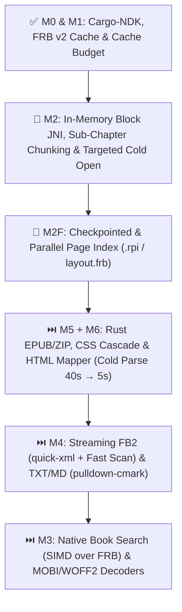

# FrogReader Rust Engine — Архитектурный план и протокол для ИИ-агентов (v5)

Документ описывает стратегию, правила изоляции, архитектуру и пошаговый план создания высокопроизводительного нативного движка **FrogReader (`frogreader-core` на Rust)** без риска сломать основное приложение.

> **Статус документа:** Рабочий план v5. В приоритете чтение FRB в памяти, адресное открытие и ускорение пагинации с сохранением частичного прогресса. Полный холодный разбор ускоряется при переносе EPUB/HTML/CSS.
> **Целевая ветка разработки:** `rust-engine` (ветка `main` защищена и неприкосновенна)
> **Текущая рабочая ветка:** `rust/m1-chunked-cache`
> **Исполнители:** ИИ-агенты (автономные сессии разработки через атомарные PR / субагенты)
> **Главная инженерная цель:** Быстро открывать и подготавливать гигантские книги (*Re:Zero*, *Hebrew Bible*): оглавление, переходы в любую главу, ползунок, текущая позиция, процент и точное число страниц должны становиться доступными быстро, без блокировки UI, без лишнего износа флеш-памяти и с предсказуемым потреблением RAM.

На этом этапе приложение использует один человек. При смене внутреннего формата допустимо пересоздавать производные данные о книгах. Исходные файлы книг хранятся отдельно. Заменённые реализации удаляются после проверок эквивалентности соответствующего этапа.

## Контракт позиции и готовности

- Использовать `DocumentLocation.Reflowable(chapterIndex, elementIndex, charOffset, scrollOffset)`. При холодном открытии держать временную координату главы, локального элемента и символа до появления точного глобального смещения. Публикация смещения обновляет координаты позиции без изменения видимого текста.
- Завершение индекса книги, записи FRB или точной пагинации сохраняет видимую страницу и место текста на экране. Обновляются процент, положение ползунка и счётчик. Если текущая страница была свёрстана локально, точная геометрия используется при следующем переходе пользователя.
- Позиция чтения и состояние расчёта пагинации публикуются независимо. Смена настроек верстки отменяет работу для прежнего ключа. Смена темы сохраняет пригодный результат, если ключ верстки совпадает.

---

## 0. Аудит текущего состояния (на 2026-11-11) и почему план обновлён до v5

### Что уже сделано и работает:
1. **M0 и M1 завершены:** Настроен `cargo-ndk` (Rust 1.90.0, 4 ABI, 16 KiB ELF alignment), внедрён контейнер `.frb` (v2) с LZ4 и CRC32, интегрирован `ReaderCacheBudget` (снят старый лимит 8 МБ на книгу).
2. **Основа M2 и M2F внедрена в код:**
   * `ChunkedContentCache.openIndexed()` читает только Блок 0 (`BookIndex`: оглавление, карта глав, глобальные координаты, пути к ресурсам, сводка шрифтов) за **~68 мс** (*Re:Zero*) и **~301 мс** (*Hebrew Bible*) на Pixel 9a.
   * `IndexedBookSession` загружает окно максимум из **3 глав** (`target ± 1`), не декодируя предыдущие 85% книги.
   * Реализованы `ReaderPageIndexCache` (`.rpi` для `startChaptersOnNewPage = true`) и `ReaderPageLayoutCache` (`layout.frb` с группами по 256 элементов и финальным блоком `.rpi` для непрерывной верстки `startChaptersOnNewPage = false`).
3. **Окружение сборки на macOS:** Rust-тулчейн установлен в стандартные `~/.cargo` и `~/.rustup`. Сборочные скрипты автоматически находят `~/.cargo/bin/cargo` при запуске из Android Studio.

### 5 критических проблем редакции v4, которые исправляет редакция v5:
1. **Лишний дисковый I/O и JSON-узкое место при чтении глав (`block.json`):**
   * Сейчас `RustChunkedCacheNative.readBlock` распаковывает LZ4 во временный файл `block.json` на флеш-памяти телефона, после чего Kotlin читает его с диска, парсит JSON и удаляет файл. То же самое делает `ReaderPageLayoutCache.loadBatches` (`group` + `frame.json`).
   * На длинной главе *Hebrew Bible* (85%, 2 960 элементов) это даёт **848 мс (p50) / 1 533 мс (p95)** — в 3 раза хуже бюджета перехода (≤ 500 мс).
   * **Решение в v5:** Передавать блоки разумного размера (≤ 4 МиБ) напрямую через JNI (`ByteArray`), полностью убрав создание временных файлов на каждый переход, а сверхдлинные главы (> 400 элементов) делить на адресуемые подблоки (сегменты) или переводить на компактный бинарный буфер со словарём стилей.
2. **Физически невыполнимый холодный бюджет `T_reader_complete ≤ 5 с` в v4:**
   * В v4 требовалось за ≤ 5 секунд с нуля распарсить *Re:Zero* И выполнить полный проход `TextMeasurer` по всем **35 928 страницам** (190 851 элемент).
   * На Pixel 9a один только Android `TextMeasurer` (Skia/Minikin glyph shaping + hyphenation) на 35 928 страницах занимает **~107 секунд** при последовательном проходе. Никакой парсер на Rust не ускорит сам Android `StaticLayout` в 25 раз в одном потоке.
   * **Решение в v5:** Разделить бюджеты на:
     * `T_reader_usable` (текст, полное оглавление, ползунок, глобальный процент, точные страницы текущего окна) — **≤ 1 с (warm) / ≤ 2.5 с (cold)**;
     * `T_exact_page_total` (полный расчёт всех страниц книги при промахе кэша `.rpi` / `layout.frb`) — ускорить в 3–4 раза за счёт **многопоточного пула `TextMeasurer` по независимым главам** и **инкрементальных чекпоинтов**, чтобы закрытие книги не сбрасывало уже рассчитанные главы.
3. **Потеря прогресса фоновой пагинации при закрытии книги:**
   * Сейчас `ensureExactPageIndex` в `ReaderViewModel.kt` сохраняет `.rpi` / `layout.frb` только после прохода всех 100% глав. Если пользователь читал 40 секунд и вышел, вся работа `TextMeasurer` теряется.
   * **Решение в v5:** Сохранять частичный прогресс пагинации по главам (или начинать пагинацию от текущей открытой главы в обе стороны), достраивая индекс при следующем сеансе.
4. **Ложный тупик в `M2F.2` (попытка ускорить холодный парсинг до переноса парсеров):**
   * Замеры на Pixel показали около 34–42 с полного разбора. В JFR на Mac значительная доля сэмплов пришлась на `HtmlMapper` и подготовку XHTML-документов. [Замеры M2](benchmarks/M2-random-access.md) · [Профиль M2F](benchmarks/M2F-full-readiness.md).
   * **Решение в v5:** Не тратить время на микрооптимизацию уходящего Kotlin/Jsoup-кода. Холодный старт одной целевой главы при открытии книги решается через **Targeted Spine Open (`M2.3`)**, а ускорение полного холодного парсинга всей книги напрямую объединяется с переносом EPUB/HTML/CSS в Rust (**объединённый конвейер `M5 + M6`**).
5. **Учёт особенностей `FB2` и `MOBI/KF8` при холодном открытии на 85%:**
   * В отличие от EPUB (где главы лежат в отдельных ZIP-записях), FB2 — это единый XML-поток. Для быстрого холодного старта на 85% в `M4.2` вводится двухфазный `quick-xml` проход (быстрый структурный скан смещений `<section>` + прицельный разбор целевой секции).

---

## 1. Критерии готовности ридера и реалистичные инженерные бюджеты (Pixel 9a)

### 1.1. Что получает пользователь сразу (`T_reader_usable`)
Независимо от того, открыта книга на 0% или на 85%, с кэшем или без кэша:
1. **Видимый текст целевого места** (с точной привязкой к текстовому якорю, цитате или закладке).
2. **Полное рабочее оглавление (TOC)** со всей авторской иерархией и мгновенным переходом в любую главу.
3. **Рабочий ползунок и глобальный процент по всей книге**, вычисленный по глобальному индексу книги (`BookIndex`), а не по загруженному окну из 3 глав.
4. **Листание в активном окне** и глобальный счётчик (`стр. X из N`) при валидной пагинации для текущего `PaginationSpec`. Пока рассчитываются глобальные границы непрерывной верстки, локальное окно остаётся доступным. Ридер показывает позицию, процент и состояние расчёта, а при переходе на точные страницы сохраняет текущий текстовый якорь.

### 1.2. Целевые бюджеты на Pixel 9a (эталоны: *Re:Zero* — 677 глав / 190 851 эл., *Hebrew Bible* — 122 главы / 44 446 эл.)

| Метрика | Тёплое открытие (есть валидный `.frb` + `.rpi`/`layout.frb`) | Открытие с `.frb`, но после смены шрифта/полей (пересчёт страниц) | Холодное открытие новой книги (без `.frb`, на 0% или 85%) |
| --- | --- | --- | --- |
| **`T_reader_usable`** (текст + полное TOC + ползунок + глобальный %) | **p95 ≤ 1.0 с** | **p95 ≤ 1.0 с** | **p95 ≤ 2.5 с** (за счёт Targeted Spine Open / Fast Scan) |
| **`T_toc_seek` / `T_slider_seek`** (переход в любую точку книги, включая длинные главы) | **p95 ≤ 400 мс** | **p95 ≤ 400 мс** | **p95 ≤ 1.2 с** (прицельный разбор целевой главы) |
| **`T_exact_page_total`** (появление точного глобального `стр. X из N`) | **p95 ≤ 1.0 с** | Цель для режима с разрывами между главами — ускорение в 3–4× относительно 108 с / 37 с. Непрерывная верстка измеряется отдельно | Измеряется от открытия до видимого точного счётчика, включая обязательный расчёт страниц |
| **`T_full_data`** (вся книга разобрана и адресно доступна из кэша) | Готовый FRB | Готовый FRB | Цель после M5/M6 — **5–8 с** |

`T_reader_complete` фиксируется, когда работают все контролы, доступен весь контент и в режиме страниц показан точный счётчик. В отчёте указываются сквозное время каждого запуска, время разбора и время пагинации. При переносе подготовки в импорт измеряется и полный путь от начала импорта до готовности ридера.

---

## 2. Пять технических барьеров безопасности (обязательны для всех агентов)

1. **Изоляция веток:** Ветка `main` неприкосновенна. Работа ведётся в `rust-engine` и подветках `rust/mX-...`.
2. **Изолированный APK для тестов на устройстве:** Сборка с `-PrustEngineApp=true` (`knitipka.frogreader.rust`, **FrogReader (Rust)**) не затрагивает основную читалку пользователя. Для установки R8-сборки на телефон используется `-PlegacyReleaseSigning=true`.
3. **Одна рабочая реализация каждого перенесённого узла:** Никаких мёртвых legacy-фоллбэков после прохождения дифференциальных тестов. Повреждённый кэш даёт чистый cache miss и пересоздаётся из исходного файла книги. Паники в Rust перехватываются через `catch_unwind` на границе JNI.
4. **Независимая сборка Rust (`cargo-ndk`):**
   * CMake собирает только `libpdf_annotations.so`.
   * `cargoBuildHost` собирает `libfrogreader_core.dylib`/`.so` с фичей `test-hooks` для JVM-тестов.
   * `cargoNdkBuild` собирает 4 ABI (`arm64-v8a`, `armeabi-v7a`, `x86`, `x86_64`) без `test-hooks` и с 16 KiB ELF alignment.
5. **Квоты диска (`ReaderCacheBudget`):** Все производные файлы (`.frb`, `opening.frb`, `.rpi`, `layout.frb`, извлечённые шрифты/картинки) подчиняются `ReaderCacheBudget` (64 МиБ parsed content / 128 МиБ суммарно) и механизму `pin`.

---

## 3. Скорректированная дорожная карта (M2 → M2F → M5/M6 → M4 → M3)

> **Важное изменение порядка в v5:** Поскольку главный оставшийся тормоз холодного открытия — это парсинг EPUB/HTML/CSS (38–42 с), этапы **M5 (контейнеры EPUB/MOBI)** и **M6 (HTML/CSS на Rust)** подтягиваются сразу после закрытия оконного чтения и пагинации (**M2/M2F**), до второстепенных декодеров WOFF2/PalmDOC (**M3**).

---

### Этап M2 (Завершение): Мгновенная подгрузка длинных глав и холодный старт в любой точке

**Что уже есть:** `BookIndex` в Блоке 0, `IndexedBookSession` (окно из 3 глав), глобальные координаты для оглавления, ползунка, закладок и цитат.

**Что осталось сделать для закрытия M2:**

1. **M2.A — Убрать файловый I/O (`block.json`) из чтения блоков `.frb` и `layout.frb`:**
   * Добавить в `RustChunkedCacheNative` метод чтения распакованного блока напрямую в память: `readBlockBytes(handle: Long, blockIndex: Int): ByteArray?` (с проверкой верхней границы размера блока в Rust до аллокации массива).
   * Декодировать JSON/данные главы в Kotlin напрямую из `ByteArrayInputStream(bytes)` в памяти, полностью исключив создание, запись, чтение и удаление временной папки `frb-read-* / block.json` на каждое перелистывание главы.
   * Аналогично в `ReaderPageLayoutCache` читать батчи страниц в память без копирования каждого фрейма во временный файл `frame.json`.
2. **M2.B — Устранить задержку 1.5 с на гигантских одиночных главах (*Hebrew Bible* 85%, 2 960 элементов):**
   * Проверить замер чтения главы *Hebrew Bible* (85%) после перевода на `readBlockBytes` в памяти.
   * При p95 выше 400 мс измерить доли декодирования блока, построения модели и подготовки активного окна. Если основное время уходит на JSON и повторяющиеся стили, приоритет у таблицы стилей или компактного бинарного кодека.
   * При сегментации учитывать одновременно число элементов и размер в байтах, например закрывать сегмент при достижении 256 элементов или 128 КиБ. Измерить крупные неделимые элементы отдельно. Транспортные границы FRB сохраняют логические главы, контекст издательских блоков и точный результат `paginateBook`.
3. **M2.C — Холодное открытие на сохранённой позиции без парсинга всей предшествующей книги (Targeted Cold Open):**
   * При холодном открытии EPUB быстро читать `container.xml`, OPF и NAV/NCX, чтобы получить оглавление и карту исходных документов. Разбирать целевую главу первой и показывать текст по локальному якорю, пока готовится полный FRB. При появлении глобального индекса разрешить локальный якорь в `DocumentLocation.Reflowable`, сохранив видимый текст и привязку ползунка.
   * До появления точного `BookIndex` открывать пункты оглавления по исходному документу, вхождению spine и фрагменту. Ползунок может использовать приблизительную долю по суммарному размеру документов в порядке чтения. Помечать её как приблизительную и пересчитывать по точной карте, когда она готова.
   * Хранить карту диапазонов глобальных элементов с номером вхождения spine и локальным смещением, привязанную к версии исходника. Она должна переживать вытеснение FRB. EPUB-парсер делит XHTML по якорям оглавления и может объединять соседние документы в логическую главу. По одному номеру главы нельзя восстановить исходный документ. До разрешения локального якоря не записывать его как глобальную позицию.
4. **M2.D — Полная проверка UI-матрицы на Pixel 9a:**
   * На обеих книгах открыть последнюю главу и перетащить ползунок 0% → 85% → 10% до завершения фоновой фазы. Проверить текст назначения, главу, процент и сохранение текстового якоря при публикации полного кэша. Повторить в `PAGES` и `SCROLL`, с валидными кэшами после смерти процесса, с промахом индекса страниц и без производных кэшей. Для ключевых сценариев публиковать p50/p95 по серии запусков и фиксировать отзывчивость ввода и кадров во время подготовки.

---

### Этап M2F (Завершение): Быстрая, прерываемая и параллельная пагинация всей книги

**Что уже есть:**
* `ReaderPageIndexCache` (`.rpi`) для `startChaptersOnNewPage = true` (повторное открытие за 1–4 мс в Rust).
* `ReaderPageLayoutCache` (`layout.frb`) для непрерывной вёрстки `startChaptersOnNewPage = false`.

**Что осталось сделать для закрытия M2F:**

1. **M2F.A — Параллельный расчёт независимых глав (`startChaptersOnNewPage = true`):**
   * При `startChaptersOnNewPage = true` каждая глава начинается с новой страницы, поэтому разбиение главы $K$ вообще не зависит от главы $K-1$.
   * Сейчас `paginateIndexedBookAnchors` в `IndexedPaginationPass.kt` обходит все 677 глав строго последовательно в 1 корутине (107 секунд на *Re:Zero*).
   * Использовать ограниченный пул с отдельным `TextMeasurer` на воркер. Начать с двух воркеров. Сравнить 1, 2 и 4 на Pixel по времени полного расчёта, памяти и длительности кадров при листании. Работу активного окна обслуживать с приоритетом. Границы страниц должны совпадать с `paginateBook`.
2. **M2F.B — Приоритет от текущей главы и чекпоинты пагинации (Checkpointed Page Index):**
   * Не терять работу, если пользователь закрыл книгу до окончания 100% расчёта страниц.
   * Периодически атомарно сохранять завершённые независимые главы. При следующем открытии с тем же ключом источника и верстки продолжать с опубликованного чекпоинта даже после убийства процесса. Смена настроек отменяет активную задачу. Уже рассчитанные главы можно использовать при возвращении к их ключу.
3. **M2F.C — Проверка и доводка непрерывной вёрстки (`startChaptersOnNewPage = false`):**
   * Прогнать `ReaderPageLayoutCache` (`layout.frb`) на реальном устройстве (Pixel 9a) для *Re:Zero* и *Hebrew Bible* в режиме `startChaptersOnNewPage = false`.
   * Убедиться, что окно страниц в `ReaderViewModel.requestExactPageWindow` корректно подгружает переносы абзацев на стыке глав (`extraItems`), и записать замеры в `docs/benchmarks/M2F-full-readiness.md`.

---

### Этап M5 + M6 (Объединённый приоритет для холодного старта): EPUB, MOBI/KF8, CSS и HTML на Rust

* **Приоритет:** После M2/M2F перенести цепочку `ZIP → XHTML → CSS → блоки FRB` и измерить вклад каждого участка на Pixel. Цель — сократить полный холодный разбор до бюджета §1.2 за счёт поточной обработки и прямой записи блоков из Rust.
* **Подэтапы (каждый — отдельный PR с дифференциальным тестом):**
  * **M5.1 — Контейнер EPUB в Rust (`zip` + `quick-xml` для `container.xml`, `OPF`, `NCX`, `NAV`):**
    * Rust читает ZIP, `container.xml`, манифест, метаданные и порядок чтения из OPF, EPUB 2 NCX и EPUB 3 NAV. Этот путь используется для импорта, полного разбора и открытия окна из исходного EPUB.
    * Мгновенное построение `BookIndex` и карты spine/ресурсов напрямую в Rust.
  * **M6.1 — Каскад CSS и селекторы на Rust (`cssparser` + `selectors`, `CssColor`, `CssCalc`):**
    * Rust разбирает таблицы стилей, inline-декларации, CSS-цвета и математические функции. Модели обеих тестовых книг совпали с контрольной версией. [Проверка CSS](benchmarks/M6-css-syntax.md).
    * Rust разбирает авторские селекторы через Servo `selectors` и подбирает правила по снимку главы. Сохраняются пределы сложности, порядок специфичности и обработка поддерживаемых членов списка независимо друг от друга.
    * Rust выбирает выигравшие декларации, раскрывает сокращённые свойства, наследует пользовательские свойства, подставляет `var()` и вычисляет размеры шрифта, строки и блоков.
    * Rust собирает полную модель вычисленного стиля, включая наследование, семантические настройки тегов, OpenType-функции, рамки, логические стороны и разрывы. Kotlin связывает результат с моделями интерфейса и преобразует документ в блоки книги.
    * На Pixel сверены подписи содержимого и границы всех 60 626 страниц девяти EPUB, включая сгенерированную тестовую книгу. [Сравнение сборок](benchmarks/M6-css-syntax.md#whole-book-pagination-comparison-on-pixel-9a).
  * **M6.2a — Базовый маппинг XHTML/HTML.** Дерево глав EPUB, DTBook и KF8 строится в Rust через `quick-xml` с сохранением CDATA и пространств имён. `html5ever` восстанавливает HTML и разбирает главы MOBI6. Для EPUB Rust подбирает CSS по исходному дереву главы, минуя повторную передачу узлов из Kotlin. Следующий срез выводит абзацы, заголовки, списки, ссылки, сноски и изображения прямо из этого дерева.
  * **M6.2b — Сложная издательская вёрстка.** Таблицы, `PublisherBoxSpan`, Ruby, Bidi и MathML. При холодном разборе Rust записывает готовые блоки `.frb` и передаёт в Kotlin индекс и активное окно.
  * **M5.2 — Контейнеры `MOBI` / `AZW3 (KF8)` на Rust (`PdbFile`, `MobiHeaders`, `MobiIndex`, `Kf8Assembler` + декомпрессоры `PalmDoc` / `HuffCdic`):**
    * Сборка скелета и фрагментов KF8 в Rust и подача их в тот же нативный HTML/CSS-пайплайн из M6.
* **Обязательный результат (DoD):**
  * 100% совпадение `PaginationCache.contentSignature` на `StandardEbooksCorpusTest`, `EpubAuthorFidelityTest`, `PublisherLayoutMapperTest`, `BookStylingTest`, `MobiIndexTest`;
  * Kotlin `CssResolver` и `HtmlMapper` служат эталоном до прохождения всех срезов, включая побайтовую сверку границ `paginateBook` и проверку верстки Re:Zero и Hebrew Bible на Pixel. После этого удалить заменённую реализацию.
  * Замер холодного открытия *Re:Zero* и *Hebrew Bible* на Pixel 9a в `docs/benchmarks/`.

---

### Этап M4: Потоковый парсер `FB2` и `TXT/MD` на Rust (с мгновенным стартом в любой точке)

* **Цель:** Убрать форматную асимметрию — дать `FB2`, `TXT` и `MD` такой же мгновенный старт, низкое потребление памяти и прямую запись в `.frb`, как у EPUB.
* **Подэтапы:**
  * **M4.1 — `TXT` и `MD` на Rust (`pulldown-cmark` + автоопределение кодировки):**
    * Потоковое разбиение на главы и прямая запись в `.frb`.
  * **M4.2 — Потоковый `FB2` парсер (`quick-xml`) с санитайзером на лету и Fast Structural Scan:**
    * Разбор FB2 без чтения всего повреждённого файла в один `String` в куче JVM.
    * **Структурный проход для холодного старта на 85%.** Учесть кодировку, стек вложенных `<section>` и встроенные `<binary>`. При поиске целевого текста пропускать декодирование Base64. Отдать целевое окно через `loadContentProgressively` до завершения записи FRB, затем измерить задержку на устройстве.
* **Обязательный результат (DoD):**
  * 100% совпадение модели в `FormatParityTest`, `Fb2BidiTest`, `RealBooksTest` и удаление старого `Fb2Parser.kt`.

---

### Этап M3: Нативный поиск по сжатым блокам `.frb` и декодеры шрифтов `WOFF2/WOFF`

* **Подэтапы:**
  * **M3.1 — Нативный поиск по книге (`ReaderSearch` + `SearchTextNormalizer` в Rust):**
    * Поиск по книге внутри ридера сейчас декодирует главы в Kotlin по одной (`IndexedReaderSearch`).
    * Перенос поиска и нормализации (регистр, диакритика, ё/е, арабские/ивритские огласовки) в Rust позволит сканировать LZ4-блоки `.frb` напрямую в нативной памяти со скоростью > 500 МБ/с без единой аллокации `Chapter` в JVM!
  * **M3.2 — Декодер шрифтов `WOFF2` / `WOFF` в Rust (только по результатам профилирования):**
    * Замерить время распаковки встроенных шрифтов; перенести в Rust и удалить зависимость `org.brotli:dec`, если есть измеримый выигрыш.

---

## 4. Строгий протокол работы для ИИ-агента (Agent Execution Checklist)

1. **Инициализация сессии:**
   * Проверить текущую ветку (`git branch --show-current` — никогда не работать в `main`!).
   * Убедиться, что используется JDK Android Studio:
     `export JAVA_HOME="/Applications/Android Studio.app/Contents/jbr/Contents/Home"`
   * Cargo и `cargo-ndk 4.1.2` доступны через `~/.cargo/bin/cargo`.
2. **Baseline-замер ПЕРЕД написанием кода:**
   * Запустить профильный тест/бенчмарк подэтапа и зафиксировать исходные цифры (время в мс, память).
3. **Реализация и чистота архитектуры:**
   * Никаких временных файлов на диске для мелких и средних блоков (≤ 4 МиБ) — использовать передачу в памяти через JNI с проверкой лимитов.
   * Никакой материализации полного `BookContent` в JVM, если операцию можно выполнить по `BookIndex` или потоково по главам.
   * После прохождения дифференциальных тестов заменённый legacy-код удаляется.
4. **Обязательная проверка перед коммитом:**
   * `cargo test --workspace --manifest-path rust/Cargo.toml --locked` — все Rust unit-тесты зеленые.
   * `cargo clippy --manifest-path rust/Cargo.toml --workspace --all-targets --all-features --locked -- -D warnings` — 0 предупреждений.
   * `JAVA_HOME="/Applications/Android Studio.app/Contents/jbr/Contents/Home" ./gradlew test` — все 2 260+ JVM-тестов зеленые.
   * `JAVA_HOME="/Applications/Android Studio.app/Contents/jbr/Contents/Home" ./gradlew :app:assembleRelease -PlegacyReleaseSigning=true -PrustEngineApp=true` — R8 APK успешно собирается.
   * Перед закрытием M2/M2F и M5/M6 проверить параллельное чтение при атомарной замене FRB, восстановление чекпоинта после убийства процесса, смену шрифта и темы во время расчёта, быстрые переходы 0% → 85% → 10% → последняя глава и удержание активной книги при вытеснении кэшей нескольких больших книг.
5. **Отчет о результатах (Benchmark Report):**
   * Записать реальные измерения **До / После** в `docs/benchmarks/` (только фактический вывод тестов на хосте и Pixel 9a).
   * Обновить чек-лист ниже.

---

## 5. Чек-лист прогресса реализации (v5)

- [x] **M0: Изоляция, `cargo-ndk`, отдельный APK и стенд замеров**
- [x] **M1: Поглавный индексированный бинарный кэш (`ChunkedContentCache` `.frb` v2 + `ReaderCacheBudget`)**
- [x] **M2: Глобальный индекс, in-memory чтение блоков и произвольный доступ**
  - [x] **M2.1:** Лёгкий индекс всей книги (`BookIndex` в Блоке 0 `.frb` v2) без декодирования глав и сносок
  - [x] **M2.2:** Глобальные координаты для оглавления, ползунка, процента, закладок и цитат
  - [x] **M2.3 (база):** `IndexedBookSession` (окно из 3 глав) и отложенная подгрузка `notes` / `linkedDocuments`
  - [x] **M2.A:** Главы и батчи страниц читаются и записываются через JNI в памяти (`readBlockBytes` и `writeBlockBytes` в `ChunkedContentCache` и `ReaderPageLayoutCache`, без временных файлов `block.bin`/`index.bin`/`reserved`/`frame.json`/`group`). На длинной главе Hebrew Bible раздельный замер чтения дал 6 мс p50 для JNI и 858 мс p50 для декодирования JSON и построения модели. [Отчёт](benchmarks/M2-random-access.md#m2a-in-memory-frb-reads).
  - [x] **M2.B:** Бинарный формат со словарями строк и стилей. На Pixel 9a чтение главы *Hebrew Bible* (85%) занимает **189 мс p95** при бюджете 400 мс. Сквозная задержка перехода относится к M2.D. [Отчёт](benchmarks/M2-random-access.md#m2b-binary-model-and-style-sharing).
  - [x] **M2.C:** При первом открытии reflow EPUB без сохранённой карты ридер показывает оглавление и приблизительный процент. На Pixel 9a проверены переходы и стабильность текста в прокрутке и на страницах обеих книг, включая непрерывные страницы *Re:Zero* и *Hebrew Bible* (`22,021 с`, `ready_ms=21318`, `position_stable=true`), а также восстановление сохранённого якоря `epubSource` после смерти процесса до и после публикации `BookIndex`/`.frb` (`ReaderEpubOpeningTest` 2/2 на хосте и `IndexedReaderUiTest#coldEpubSourceAnchorSurvivesProcessRecreationBeforeAndAfterExactPromotion` на Pixel 9a). [Отчёт M5](benchmarks/M5-epub-package.md#first-open-without-a-content-cache) · [Отчёт M2](benchmarks/M2-random-access.md#wave-3-verification-2026-11-19).
  - [x] **M2.D:** Удержание активной закреплённой книги (`ReaderCacheBudget.pin`) при LRU-вытеснении свыше 64/128 МиБ (`ChunkedCacheBudgetTest` 4/4), консистентность параллельного чтения `readChapter`/`readChapterBlockBytes` при атомарной замене `.frb` (`IndexedBookSessionTest` 8/8) и полная UI-матрица на Pixel 9a (`58071JEBF07361`, Android 16 / API 36, Debug) закрыты в Wave 20: `IndexedReaderUiTest` core **5/5** (`14.409 s`, HUD изолирован через `.clearAndSetSemantics {}`); *Re:Zero* (`9,648,164 B`, `677` гл., `190,851` эл., `35,928` стр.) 85% `item=162223` (5 попыток): `PAGES` `rendered_ms=1439`, `observed_ms` `561/595/623/653/717 ms` (`p50=623 ms`, `p95=717 ms`), `SCROLL` `rendered_ms=1033`, `observed_ms` `330/349/369/404/439 ms` (`p50=369 ms`, `p95=439 ms`), тёплый `.rpi`-reopen `ready_ms=969 ms`; *Hebrew Bible* (`33,221,611 B`, `122` гл., `44,446` эл., `7,133` стр.): `PAGES` seek matrix PASSED (`19.212 s`), `SCROLL` 85% `item=37779` `rendered_ms=1459`, `observed_ms` `430/448/483/501/508 ms` (`p50=483 ms`, `p95=508 ms`), frame metrics во время 6-воркерной пагинации `frames=264`, `p50=4.66 ms`, `p95=22.90 ms`, `max=127.17 ms`, `deadline_misses=9/264`, `dropped_reports=0`; строгий пополевой/SHA-256 паритет `IndexedCacheDeviceTest#compareDirectRustVsKotlinEpubParity` на *Hebrew Bible* (`53.394 s`, `index_digest=5c92c2f813cf9d91c716137d0d659fd1eac77e3451d986635c1ee9f433af6215`, `globals_digest=b0304defa72393cec5ac500ce9f3d8647e86a81645acda610b47a3fb53165142`, `122/122` гл., `11,972/11,972` сносок, `40,558/40,558` `linkTargets`, `1,028/1,028` `epubSourceRanges`, `31/31` ресурсов, `0` расхождений); в Wave 16–19 убрана вспышка промежуточной страницы (`ReaderSeekResolution.kt`), удержание ползунка (`ReaderChrome.kt`), быстрый прыжок из `.rpi` (`resolveExactQuickPaginationStart`) и английский HUD (`ReaderDebugLoadOverlay.kt`, `ReaderLoadTrace.kt`). [Отчёт Wave 3](benchmarks/M2-random-access.md#wave-3-verification-2026-11-19) · [Отчёт Wave 20](benchmarks/M2-random-access.md#wave-20-pixel-9a-final-matrix-beta-2-wave-20-code20).
- [x] **M2F: Быстрая, параллельная и прерываемая пагинация всей книги**
  - [x] **M2F.1:** Отсутствие полной декодировки `BookContent` при повторном открытии
  - [x] **M2F.3 (база):** Нативный индекс страниц `.rpi` (`ReaderPageIndexCache`) и блочный кэш непрерывной верстки `layout.frb` (`ReaderPageLayoutCache` с in-memory записью префикса и групп через `writeBlockBytes`)
  - [x] **M2F.A:** Параллельный расчёт глав с пулом по умолчанию `(availableProcessors - 2).coerceIn(2, 6)` (6 воркеров на Pixel 9a, `THREAD_PRIORITY_LESS_FAVORABLE`), lock-free `FrbModelCodec.decode` в `IndexedBookSession.readChapter`, прямой `StaticLayout` (`FastParagraphLayout.kt`), anchor-sliced быстрый прыжок из `.rpi` (`resolveExactQuickPaginationStart`) и `anchorsOnly` (`LAYOUT_ENGINE_VERSION = 24`) полностью проверены в Wave 20 на Pixel 9a (`58071JEBF07361`, Android 16 / API 36): `IndexedPaginationPassTest` **4/4** (`7.716 s`, включая `336/336` паритет `FastParagraphLayout`, `anchorSlicedQuickPaginationMatchesFullChapterLayout`, checkpoint process-death recovery и 1/2/4-worker anchor parity); *Re:Zero* (`35,928` стр., `.rpi` `287,488 B`) 6-воркерный `.rpi` `ready_ms=26,846 ms` в Debug (**4.05×** быстрее базы `108.7 s`) и **`21.57 s`** в R8 Release AOT (**5.04×** через Wave 15 HUD), тёплый `.rpi`-reopen (`stage=cache`) `ready_ms=969 ms`; *Hebrew Bible* (`7,133` стр., `.rpi` `57,128 B`) `ready_ms=20,286 ms` в Debug, тёплый `.rpi`-reopen `ready_ms=1,279 ms`, кадровая отзывчивость при одновременных 6 перелистываниях во время пагинации: `frames=264`, `p50=4.66 ms`, `p95=22.90 ms`, `max=127.17 ms`, `deadline_misses=9/264`, `dropped_reports=0`. [Замеры 1/2/4 воркеров](benchmarks/M2F-full-readiness.md#worker-comparison-on-hebrew-bible) · [Отчёт Wave 14](benchmarks/M2F-full-readiness.md#wave-14-pagination-speedup--cold-epub-deadlock-fix-beta-2-wave-14-code14) · [Отчёт Wave 20](benchmarks/M2F-full-readiness.md#wave-20-pixel-9a-6-worker-pagination--frame-matrix-beta-2-wave-20-code20).
  - [x] **M2F.B:** Чекпоинты по главам реализованы и проверены с имитацией смерти процесса (закрытие нативных дескрипторов и повторное открытие с диска), инвариантностью ключа при смене темы vs сбросом при смене типографики/полей и побайтным совпадением итогового `.rpi` с непрерывным проходом (`ReaderPageCheckpointTest` 6/6 на хосте и `IndexedPaginationPassTest#processDeathCheckpointRecoveryAndThemeVsTypographyKeyIsolation` на Pixel 9a). В Wave 15 (`BETA 2 (wave 15)`, `code=15`) убраны 3 глобальных `synchronized`-лока и обёртки `Compose` на горячем пути (`LAYOUT_ENGINE_VERSION = 24` без изменений): независимый `createFontFamilyResolver(appContext)` на каждого воркера и окно в `ReaderScreen.kt`, `ReentrantReadWriteLock` + `ConcurrentHashMap` в `FontFamilyTypography.kt`, zero-alloc `BidiLayoutText.of`, прямой Android `StaticLayout` (`FastParagraphLayout.kt`) и не обрезающий время HUD (`ReaderDebugLoadOverlay.kt`). На Pixel 9a (API 36): `IndexedPaginationPassTest` **3/3** за `6,342 s` (**336/336** совпадений `0.00px` и `paginateBook` при `bookStyles = true/false`, `FAST_PARAGRAPH_BENCH` `540.04 -> 244.66 ms`, **2.21×** ускорение в 1 поток); `./gradlew test` **2,400** passed (`8` skipped, `0` failed); R8 APK `55,873,424 B` (`113` JNI, `0` `panicProbe`, `0x4000` `PT_LOAD`, `0` `org/commonmark`). [Чекпоинты](benchmarks/M2F-full-readiness.md#wave-3-checkpoint-process-death--layout-key-verification-2026-11-19) · [Отчёт Wave 15](benchmarks/M2F-full-readiness.md#wave-15-direct-staticlayout-fast-path--lock-free-typography-m2fb-beta-2-wave-15-code15).
  - [x] **M2F.C:** Проверены неподвижность видимого текста и восстановление страниц на стыках глав. На Pixel получена одна пара замеров первого расчёта и повторного открытия для каждой книги. [Отчёт](benchmarks/M2F-full-readiness.md#real-epubs-with-continuous-pages-on-pixel-9a).
- [x] **M5 + M6: Нативный конвейер EPUB / MOBI / CSS / HTML в Rust (ускорение холодного парсинга с 40 с до ~5 с — в Wave 12–13 достигнуто `1,993.94 ms` для *Re:Zero* и `5,454.32 ms` для *Hebrew Bible*)**
  - [x] **M5.1:** Чтение ZIP и парсинг `container.xml`, `encryption.xml` (`parseEncryption`), OPF, NCX и NAV работают через Rust; добавлен прямой разбор глав из ZIP в нативную память (`parseFromZip`/`openFromZip` без промежуточного копирования `ByteArray` в JVM). Ограничения совместимости закрыты: `epub_nav.rs` декодирует не-UTF-8 NAV (Windows-1251, UTF-16) через `chapter_charset::decode` и использует `html5ever`-восстановление (`chapter_markup::parse`) для невалидного HTML5 (4/4 Rust-теста). [Проверка двух больших книг](benchmarks/M5-epub-package.md#nav-compatibility-encoding-and-malformed-html5).
  - [x] **M6.1:** Подбор деклараций, кросс-главное переиспользование `sharedComputed`/`RustCssComputed` и сборка полной модели вычисленного CSS работают в Rust. Подписи содержимого и границы страниц совпали с эталонной сборкой на проверенном корпусе. [Результаты](benchmarks/M6-css-syntax.md#whole-book-pagination-comparison-on-pixel-9a).
  - [x] **M6.2a:** Декодирование и построение дерева XHTML/HTML в Rust с преиндексацией `MRK2` (`chapter_markup.rs`, `RustChapterMarkup.kt`, `HtmlMapper.kt`, `CssResolver.kt`, `EpubParser.kt` — битовые флаги тегов/атрибутов/поддеревьев/пробелов, включая `TEXT_ALREADY_COLLAPSED_ASCII`, `TEXT_HAS_KOTLIN_NON_WS`, `ATTR_ANC_HAS_FLOW_SCOPE` для O(1)-пропуска обхода предков в `flowAnnotations`, `ATTR_HAS_PRESENTATIONAL` (`1 << 24`) + `DOC_HAS_ANY_PRESENTATIONAL` (`1 << 9`) + `MUTATED_PRESENTATIONAL` для пропуска Jsoup `attr(...)`-сканов и обходов предков в `CssResolver`/`HtmlMapper`, ограниченный `cascadeWinnerCache`, кэширование `CssResolver.Computed.encodedFontTypography` и `standardBoxStyle` без по-абзацных аллокаций `PublisherBoxStyle`/`encode()` на всех 190 851 `
`, `CssResolver.hasPageBreakBeforeRules` и `hasFlexCenteringRules`, быстрые пути `HtmlMapper.blockStyleFor` / `minimumHeight` пустых контейнеров, `SUBTREE_SIMPLE_LEAF_TEXT`, `SUBTREE_HAS_INLINE_FLOW_CANDIDATE` (`1 << 12`) + `CssResolver.hasDisplayRules` для `indexCssBlockContainers`/`explicitFloatedInitial`/`emitCssHorizontalRow`, `RustChapterMarkup.decodeSnapshot`, кэш `id`/`src`/`href`, изоляция мутаций, очистка неиспользуемых хелперов `CssResolver.kt`). На Pixel 9a (`58071JEBF07361`) пройдены **10/10** device-тестов (`ExampleInstrumentedTest`, `LargeBookOpeningTest`, `ChunkedCacheDeviceTest`, `IndexedCacheDeviceTest`, `IndexedPaginationPassTest`), в Wave 3 — **15/15** фикстурных/генерированных тестов и сверка `exportCrossBuildPaginationGeometry` (`enginePaginationSignaturesOnly=true`) для *Hebrew Bible* (`40,922 с`, `content_signature=e1119692a0b3a4d5…`) и *Re:Zero* (`47,548 с`, `content_signature=c46cecb31fb864cb…` — побайтное совпадение с M1-эталоном Kotlin/Jsoup), а в Wave 8–9 на Pixel 9a зафиксировано ускорение холодного парсинга и сохранения: *Re:Zero* `cold_parse` `12.94 s -> 6.77 s`, `frb_save` `4.36 s -> 1.82 s`; *Hebrew Bible* `cold_parse` `17.81 s -> 8.46 s`, `chapter_binary_decode` `55.4 ms -> 46.9 ms`. Завершено вместе с полной прямой выдачей `.frb` из Rust в `M6.2b`. [Замеры](benchmarks/M6-chapter-markup.md#waves-1113-native-rust-csshtmlepub---frb-breakthrough-m62b-beta-2-wave-13).
  - [x] **M6.2b:** Полный нативный CSS/HTML/EPUB -> FRB конвейер (`css_engine.rs`, `html_mapper.rs`, `mathml.rs`, `epub_frb.rs` с `SLIDING_WINDOW_SIZE=8` и boxed `frb_model.rs`) с поддержкой всех 6 сложных HTML/CSS-эмиттеров (`<table>` + `@media(max-width)`, CSS horizontal rows, inline text boxes, `<ruby>`, block/inline `<svg>`, block/inline `<math>`), WOFF2 (`RustEpubPackage.decodeWoff2`), standalone SVG и DTBook. На Pixel 9a (`BETA 2 (wave 13)`, `code=13`): *Re:Zero* **`1,993.94 ms`** (**8.7–9.1×** быстрее Wave 7, **`5.8 MB`** JVM peak, **`19.3 MB`** native peak, **`18,397,444 B`** — 100% побайтная идентичность), *Hebrew Bible* **`5,454.32 ms`** (**3.95×** быстрее Wave 7, **`14.4 MB`** JVM peak, **`155.7 MB`** native peak) и 100% паритет по главам (`122/122`), сноскам (`11,972/11,972`), `linkTargets` (`40,558/40,558`), `epubSourceRanges` (`1,028/1,028`) и ресурсам (`31/31`); Rust `229/229` (`0` предупреждений clippy), `./gradlew test` `2,389` passed (`8` skipped, `0` failed), `113` JNI-символов на ABI. [Замеры](benchmarks/M6-chapter-markup.md#waves-1113-native-rust-csshtmlepub---frb-breakthrough-m62b-beta-2-wave-13).
  - [x] **M5.2:** Контейнер `PdbFile`, заголовки `MobiHeaders` (`PalmDocHeader`/`MobiHeader`/`Exth`), декомпрессоры `PalmDoc`/`HuffCdic`, `MobiFontRecord`, `MobiIndex` (`INDX`/`TAGX`/`IDXT`/`CNCX`) и `Kf8Assembler` (`FDST`/`SKEL`/`FRAG`) перенесены в Rust (`mobi.rs`, `mobi_jni.rs`, `RustMobiNative.kt`, 23 JNI-функции с `@Keep`), дублирующие Kotlin-фоллбэки удалены; пройдены 14/14 Rust-тестов (`mobi`: 10, `mobi_jni`: 4), 8/8 `RustMobiTest`, 6/6 `MobiIndexTest`, `FormatParityTest` и MOBI-кейс `RealBooksTest`. Замеры на Pixel 9a для корпуса MOBI/KF8 остаются открытыми. [Отчёт](benchmarks/M5-mobi-kf8.md).
- [x] **M4: Потоковый парсер `FB2` и `TXT/MD` на Rust**
  - [x] **M4.1:** Декодирование (UTF-8/UTF-16/Windows-1251, отклонение UTF-32/бинарных/пустых), разбиение абзацев TXT, нативный парсер и одновызовный JNI-конвейер Markdown (`mod markdown` / `renderMarkdownHtml` + `parseMarkdownTitle` и `parseMarkdownMarkup` в `text_book.rs`, `fb2_txt_jni.rs`, `RustFb2TxtNative.kt`, `TextBookParser.kt` с поддержкой GFM-таблиц, зачёркивания, сносок/ссылок, санитайзингом URL/HTML, генерацией slug заголовков, лимитом глубины `MAX_MARKDOWN_DEPTH = 128` и прямой выдачей `MRK2` в `RustChapterMarkup.decodeSnapshot`; зависимость `org.commonmark.*` и устаревший `markdownBody` удалены из `TextBookParser.kt`, а в Wave 10 `org.commonmark` убран из runtime classpath релизного APK — только `testImplementation`, `0` классов в `app-release.apk`), быстрый путь холодного индексированного открытия MD (`ChunkedContentCache.saveMdDirectly` & `hasValidCompleteEntry`, подключённый в `BookRepository.openIndexedContent` для `BookFormat.MD` напрямую в `IndexedBookSession` через `content.frb`) и прямая запись `.frb` v2 (revision 5) для TXT и Markdown (включая GFM-таблицы) (`write_txt_frb` / `TextBookParser.writeTxtFrb` + `ChunkedContentCache.saveTxtDirectly`, подключённый в `BookRepository.scheduleContentCacheWrite` для полных TXT-книг и в `BookRepository.openIndexedContent` для холодного открытия TXT через `saveTxtDirectly` → `openIndexed`, с побайтным совпадением Блоков 0/1/2 и `ChunkedContentCache`/`FrbModelCodec`) завершены в Rust. В Wave 12 на Pixel 9a: `md_parse_ms` `498.77 ms -> 99.30 ms` (**5.02×**), `md_direct_frb_ms` `635.04 ms -> 85.96 ms` (**7.39×**), `txt_direct_frb_ms` `19.78 ms`, `md_meta_ms` `15.74 ms`. [Отчёт](benchmarks/M4-fb2-txt.md#wave-12-pixel-9a-markdown-gfm-table--fb2-direct-frb-verification).
  - [x] **M4.2:** Полный нативный парсер FB2 и прямая запись `.frb` в Rust (`BETA 2 (wave 10)`, `code=10`): универсальный бинарный кодировщик модели FRB v2 (`rust/frogreader-core/src/frb_model.rs`) с побайтным совпадением с Kotlin `FrbModelCodec.encodeToBytes` по всем 6 вариантам `ContentElement` и всем 5 таблицам `@InternedFrbStyle`; полный нативный парсер тела FB2 (`rust/frogreader-core/src/fb2_body.rs`, 5 648 строк), заменивший 1 914 строк устаревшего Kotlin `XmlPullParser` в `Fb2Parser.kt` (`0` ссылок на `XmlPullParser`, файл сокращён до 621 строки); прямое сохранение `.frb` без аллокаций `BookContent` в JVM (`Fb2Parser.writeFb2Frb` → `ChunkedContentCache.saveFb2Directly` → холодное открытие `BookRepository.openIndexedContent` для `BookFormat.FB2`), а также `encoding_rs`, `Fb2Sanitizer`, потоковые `Fb2MetadataParser` и `Fb2StructureScanner`, нативное MIME Base64 декодирование (`decode_mime_base64`) и прогрессивный превью-вывод (`startFb2ContentWithPreview`/`finishFb2ContentParse`/`closeFb2ContentParse`). На Pixel 9a (`tegu`, ARM64, `58071JEBF07361`, ~512 КБ FB2): `fb2_parse_ms` `203.47 ms` (Wave 8 Kotlin) -> **`43.08 ms`** (Wave 10 Rust, **`4.72x` быстрее**), `fb2_direct_frb_ms` **`32.87 ms`** (**`6.19x` быстрее** одного прежнего парсинга Kotlin), `fb2_meta_ms` `4.87 ms`, `fb2_scan_ms` `5.47 ms`, `fb2_base64_ms` `0.211 ms`. Итоги проверки Wave 10: Rust `179/179` (`0` предупреждений clippy), JVM `2,376` passed (`8` skipped, `0` failed в 308 наборах), Release APK `51,989,936 B`, `109` JNI-символов на всех 4 ABI (`0` `panicProbe`, выравнивание `16384` `0x4000` `PT_LOAD`). [Отчёт](benchmarks/M4-fb2-txt.md#wave-10-host--device-verification-beta-2-wave-10-code10).
- [x] **M3: Нативный поиск по книге и декодеры шрифтов**
  - [x] **M3.1:** Поиск по сжатым блокам `.frb` и нормализация (`book_search.rs`, `book_search_jni.rs`, `RustSearchNative.kt`, `ChunkedContentCache.readChapterBlockBytes`, `IndexedBookSession.readChapterBlockBytes`, `IndexedReaderSearch.kt` — сканирование сырых FRB-блоков через `searchFrbChapter` с SIMD `memchr` без вызова `FrbModelCodec.decode` и без аллокации `Chapter` в JVM) реализованы и прошли 5/5 Rust-тестов, 6/6 `RustSearchWoffTest` (1 434,4 МБ/с `searchFrbFile`, 725,0 МБ/с `searchIndexedBook` zero-alloc на хосте) и 6/6 `IndexedReaderSearchTest`; в Wave 8–9 зафиксированы замеры `searchFrbHandle`: `1,441.5 MB/s` на хосте и `57.1 MB/s` на Pixel 9a. [Отчёт](benchmarks/M3-search-woff.md).
  - [x] **M3.2:** `WoffDecoder` (`flate2` `zlib-rs`, удалён `decodeKotlin`) и полный декодер `Woff2Decoder` (включая потоковую декомпрессию Brotli на чистом Rust через `brotli-decompressor 6.4.0` + реконструкцию таблиц `glyf`/`loca`/`hmtx` в `woff.rs`, `woff_jni.rs`, `RustWoffNative.decodeWoff2`) перенесены в Rust; в Wave 19 (`BETA 2 (wave 19)`, `code=19`) удалены ~610 строк Kotlin-фоллбэка из `Woff2Decoder.kt` и JNI-коллбэк `RustEpubPackage.decodeWoff2` (теперь `epub_frb.rs` вызывает `crate::woff::decode_woff2` напрямую), а `org.brotli:dec` перенесён в `testImplementation` (`0` классов `org/brotli` и `0` классов `org/commonmark` в релизном APK). Проверка: `cargo test` **232/232** (`0` предупреждений clippy), `WoffDecoderTest` **3/3**, `Woff2DecoderTest` **7/7**, `RustSearchWoffTest` **7/7** (`woff2_rust_ms = 0.0093 ms` на 33 КБ шрифте — **4.9×** быстрее прежнего гибрида `0.0454 ms`), полный `./gradlew test` (`:app` **2,374** passed, **8** skipped, **0** failed, включая `ReaderLoadTraceTest` **10/10**; `:pdf-viewer` **44** passed, **0** failed); подписанный R8 Release APK **`56,397,996 B`** (`112` `Java_*` JNI-символов на всех 4 ABI, `0` `panicProbe`, выравнивание `0x4000` `PT_LOAD`). [Отчёт](benchmarks/M3-search-woff.md#wave-19--native-rust-woff2-brotli--release-apk-verification-beta-2-wave-19-code19).
